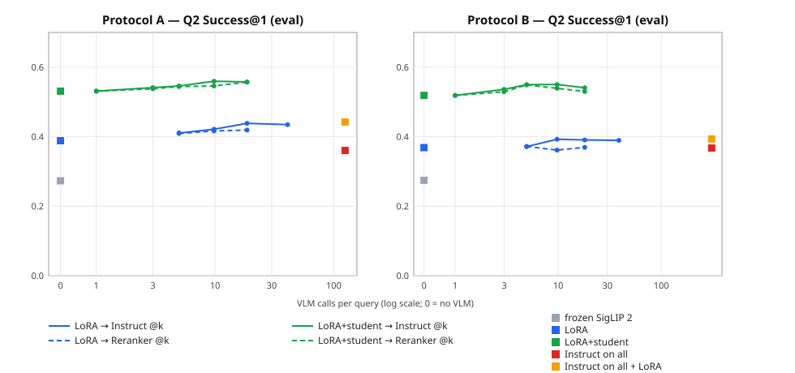

# Result 04 — VLM teacher, temporal student re-ranker and the recall-vs-cost curve, eval split

**Date:** 2026-10-31 · **Spec:** `docs/planning/spec-rerank-cascade.md` · **Log:** D-022, D-023, D-024
**Inputs:** crop store `data/crops_v2` (tight PNG / context JPEG), `manifest_v2.csv`, frozen phrasings
`queries/phrasings.csv` (sha256 `bfd6456a…`), training captions `queries/train_captions.csv`
(sha256 `139d6fc1…`), LoRA runs A-middle / B-uniform (Result 03), VLM weights
Qwen3-VL-2B-Instruct @ `ae9985b2` and Qwen3-VL-Reranker-2B @ `5b295e98` (ModelScope mirror, sha256-checked).
**Raw output:** `docs/results/raw/04_*` — gate reports (`04_g0_*`, `04_g1*`), student selection and
training logs (`04_student_*`), the cascade report (`04_cascade.json`), every query × system
(`04_cascade_queries.csv.gz`) and per-activity results (`04_cascade_per_activity.csv`).
**Figure:** `docs/results/04_cascade_curve.svg`.
**Reproduce:** README, section "Re-ranking cascade" (steps 0–4), then
`python scripts/cascade_report.py ... --hypotheses runs/cascade/04_hypotheses.md`.

Every choice below was fixed on **validation** before eval was read: the VLM view and teacher (G1),
the student variant and its fusion weight β, and the VLM fusion weights γ. Eval was read once, by
`sfs.eval.cascade_run report`.

---

## Setup

| Stage | What it is | Cost per query |
|---|---|---|
| Frozen SigLIP 2 | Result 02 baseline, tight crops | 0 VLM calls |
| LoRA | Result 03 retriever (A-middle / B-uniform) | 0 |
| LoRA + student | Temporal transformer over per-frame [LoRA tight, frozen context, 12 box-motion features] with the query text; fused as z(student) + β·z(LoRA) | 0 (≈0.18 s for the whole eval corpus) |
| … → VLM @k | The VLM re-orders the top k by z(VLM) + γ·z(previous) | k calls |
| VLM on all (Q2) | Instruct scores every candidate in the window | window size |

- **VLM score:** log p("yes") − log p("no") for "Does this video show the following: {query}?"
  (Instruct), or the Reranker's own yes/no head with its trained template. 8 evenly spaced frames,
  longest side 448 px, real frame times passed as video metadata.
- **Student training:** pairs from the train split = each class's positives + 100 hard + 100 random
  negatives (~12.2k pairs per protocol). Targets: GT = human label; KD = σ(teacher margin);
  GT+KD = average of the two. Early stopping on validation Q1 mAP.

## Gates (validation)

**G0 — does it fit the laptop (RTX 4060, 8 GB)? Pass for both.**

| Model | Peak VRAM | Uncached time per pair | Cached, 64 texts per clip | Deterministic |
|---|---|---|---|---|
| Qwen3-VL-2B-Instruct | 6.1 GB | 0.17 s | 0.64 s | yes |
| Qwen3-VL-Reranker-2B | 4.4 GB | 0.16 s | — (query comes first) | yes |

The Instruct cached-vs-uncached check gave a difference of 0.37, against the spec's 0.1 limit. This is
bf16 rounding, not a defect. Two mathematically identical uncached runs (eager vs sdpa attention)
differ by up to 0.90. Cached vs uncached has rank correlation 0.995, and the fp32 unit test shows the
cached path is exact. **Flagged for owner feedback; the cached path was used.**

**G1 — does the VLM add information? Fail for all four configurations.** The test re-ranks the LoRA
top-50 of each validation Q1 query and needs a gain of at least +0.02 mAP on one protocol.

| Config | A: LoRA → fused (VLM alone) | B: LoRA → fused (VLM alone) |
|---|---|---|
| instruct-tight | 0.437 → 0.446 (0.394) | 0.378 → 0.380 (0.353) |
| instruct-context | 0.437 → 0.425 (0.354) | 0.378 → 0.379 (0.335) |
| **reranker-tight (teacher)** | 0.437 → 0.440 (0.388) | 0.378 → 0.390 (0.349) |
| reranker-context | 0.437 → 0.429 (0.368) | 0.378 → 0.378 (0.335) |

Inside the top-50, the VLMs rank right above wrong clips with AUC 0.54–0.63; LoRA reaches 0.69–0.75.
Ranking by the VLM alone gives 0.39 mAP on A, against 0.31 for random order. So the signal is real
but weaker than LoRA. Every configuration chose the largest LoRA weight. The tight view beats the
context view for both models. **Flagged for owner feedback.** The work continued with the pre-set
rule, which picks the best mean gain: the Reranker on tight crops.

## Students (validation, selection)

| Protocol | LoRA alone | GT | GT+KD | KD | Selected |
|---|---|---|---|---|---|
| A | 0.437 | **0.600** | 0.594 | 0.424 | GT |
| B | 0.378 | **0.566** | 0.539 | 0.377 | GT |

The teacher is weak on the training pairs too: AUC 0.62, with soft targets averaging 0.46 for
positives and 0.41 for negatives. β = 1 was chosen for every student. A wider check (β up to 8)
peaks at β = 1–2, so the grid was adequate. The VLM fusion weights chosen on validation were γ = 2
everywhere, the largest weight on the first stage.

## Headline (eval split, macro over activities)

| Prot. | System | VLM calls / Q2 query | Q2 S@1 | Q2 S@5 | Q2 MRR | Q1 mAP | Q1 P@10 |
|---|---|---|---|---|---|---|---|
| A | frozen SigLIP 2 | 0 | 0.273 | 0.655 | 0.446 | 0.179 | 0.259 |
| A | LoRA | 0 | 0.389 | 0.797 | 0.558 | 0.313 | 0.408 |
| A | **LoRA + student (GT, selected)** | **0** | **0.531** | **0.900** | **0.690** | **0.476** | **0.527** |
| A | LoRA + student (GT+KD, ablation) | 0 | 0.528 | 0.891 | 0.685 | 0.455 | 0.497 |
| A | LoRA + student (KD, ablation) | 0 | 0.367 | 0.755 | 0.535 | 0.291 | 0.354 |
| A | student alone (no LoRA fusion) | 0 | 0.460 | 0.867 | 0.636 | 0.393 | 0.409 |
| A | LoRA → Instruct @10 | 9.8 | 0.421 | 0.821 | 0.586 | 0.314 | 0.408 |
| A | LoRA → Reranker @10 | 9.8 | 0.416 | 0.819 | 0.580 | 0.314 | 0.408 |
| A | LoRA + student → Instruct @5 | 5.0 | 0.546 | 0.900 | 0.702 | 0.477 | 0.527 |
| A | LoRA + student → Instruct @10 | 9.8 | **0.560** | 0.912 | **0.710** | 0.478 | 0.527 |
| A | LoRA + student → Reranker @10 | 9.8 | 0.546 | 0.918 | 0.702 | 0.477 | 0.527 |
| A | Instruct on all candidates | 124.5 | 0.360 | 0.729 | 0.523 | 0.207† | 0.312† |
| A | Instruct on all + LoRA | 124.5 | 0.442 | 0.820 | 0.602 | 0.306† | 0.389† |
| B | frozen SigLIP 2 | 0 | 0.275 | 0.703 | 0.460 | 0.174 | 0.274 |
| B | LoRA | 0 | 0.369 | 0.723 | 0.528 | 0.280 | 0.362 |
| B | **LoRA + student (GT, selected)** | **0** | **0.519** | **0.848** | **0.663** | **0.442** | **0.521** |
| B | LoRA + student (GT+KD, ablation) | 0 | 0.514 | 0.870 | 0.665 | 0.423 | 0.470 |
| B | LoRA + student (KD, ablation) | 0 | 0.304 | 0.654 | 0.460 | 0.248 | 0.273 |
| B | student alone (no LoRA fusion) | 0 | 0.475 | 0.815 | 0.628 | 0.391 | 0.408 |
| B | LoRA → Instruct @10 | 9.7 | 0.393 | 0.746 | 0.548 | 0.280 | 0.362 |
| B | LoRA → Reranker @10 | 9.7 | 0.362 | 0.751 | 0.529 | 0.280 | 0.362 |
| B | LoRA + student → Instruct @5 | 4.9 | **0.550** | 0.848 | **0.685** | 0.442 | 0.521 |
| B | LoRA + student → Instruct @10 | 9.7 | 0.550 | 0.854 | 0.684 | 0.443 | 0.521 |
| B | LoRA + student → Reranker @10 | 9.7 | 0.539 | 0.849 | 0.679 | 0.441 | 0.521 |
| B | Instruct on all candidates | 307.8 | 0.367 | 0.729 | 0.531 | 0.212† | 0.312† |
| B | Instruct on all + LoRA | 307.8 | 0.394 | 0.771 | 0.560 | 0.287† | 0.386† |

The Q1 columns of the VLM rows use the same budget k on the whole-corpus ranking. † Added
2026-11-03 (spec-vlm-followups E5, D-028; `docs/results/05-vlm-followups.md`): Instruct on every Q1
candidate, 3,726 (A) / 3,938 (B) VLM calls per Q1 query, same γ; every other number in this table is
unchanged. On 2026-10-31 this point was not computed (§11 of the spec). The frozen and LoRA rows match Results 02
and 03. Every system at every budget, including @1/@3/@20/@50, is listed in
`docs/results/raw/04_cascade.json`.

**Estimated latency per Q2 query.** This is the number of VLM calls × 0.17 s (uncached, G0) plus the
student. The student time of 0.18 s is measured over the whole eval corpus, so it is an upper bound.

| System | A | B |
|---|---|---|
| LoRA + student | 0.18 s | 0.19 s |
| LoRA + student → Instruct @5 | 1.0 s | 1.0 s |
| LoRA + student → Instruct @10 | 1.8 s | 1.8 s |
| Instruct on all candidates | 21 s | 52 s |

## Paired differences (eval, 95 % CI, bootstrap over activities, 10,000 resamples)

| Comparison | A | B |
|---|---|---|
| student − LoRA, Q2 MRR | +0.132 [+0.065, +0.202] | +0.135 [+0.074, +0.199] |
| student − LoRA, Q1 mAP | +0.163 [+0.097, +0.239] | +0.162 [+0.094, +0.235] |
| student − LoRA, Q2 S@1 | +0.143 [+0.058, +0.228] | +0.150 [+0.082, +0.220] |
| LoRA → Instruct @10 − LoRA, Q2 S@1 | +0.033 [−0.002, +0.070] | +0.024 [−0.001, +0.051] |
| LoRA → Reranker @10 − LoRA, Q2 S@1 | +0.028 [+0.000, +0.057] | −0.007 [−0.030, +0.017] |
| student → Instruct @10 − student, Q2 S@1 | +0.028 [+0.003, +0.054] | +0.031 [−0.001, +0.067] |
| student → Reranker @10 − student, Q2 S@1 | +0.015 [−0.010, +0.040] | +0.020 [−0.013, +0.059] |
| GT+KD student − GT student, Q1 mAP | −0.021 [−0.062, +0.014] | −0.019 [−0.059, +0.018] |
| KD student − GT student, Q1 mAP | −0.185 [−0.263, −0.118] | −0.194 [−0.272, −0.120] |
| Instruct on all − LoRA, Q2 S@1 | −0.028 [−0.128, +0.063] | −0.001 [−0.114, +0.105] |

## Per activity

Ordered by frozen-baseline lift on A (Result 02). The last column follows Q2 S@1 on A across three
systems: LoRA → LoRA + student → LoRA + student → Instruct @10.

| Activity | Lift (A) | Q1 AP A: LoRA → student | Q1 AP B: LoRA → student | Q2 S@1 A |
|---|---|---|---|---|
| person_enters_vehicle | 21.8 | 0.248 → 0.259 | 0.177 → 0.220 | 0.33 → 0.33 → 0.42 |
| person_talks_on_phone | 20.6 | 0.687 → 0.644 | 0.498 → 0.453 | 0.89 → 0.77 → 0.84 |
| vehicle_reverses | 19.0 | 0.121 → 0.203 | 0.125 → 0.408 | 0.30 → 0.33 → 0.33 |
| vehicle_turns_left | 12.5 | 0.327 → 0.273 | 0.345 → 0.375 | 0.57 → 0.22 → 0.26 |
| hand_interacts_with_person | 10.3 | 0.198 → 0.334 | 0.185 → 0.434 | 0.38 → 0.57 → 0.52 |
| vehicle_turns_right | 10.1 | 0.285 → 0.347 | 0.294 → 0.255 | 0.30 → 0.54 → 0.54 |
| person_exits_vehicle | 9.7 | 0.183 → 0.358 | 0.232 → 0.423 | 0.45 → 0.60 → 0.57 |
| person_closes_vehicle_door | 9.2 | 0.190 → 0.368 | 0.197 → 0.324 | 0.04 → 0.44 → 0.44 |
| person_opens_vehicle_door | 8.1 | 0.256 → 0.343 | 0.245 → 0.293 | 0.22 → 0.33 → 0.48 |
| vehicle_stops | 6.4 | 0.184 → 0.246 | 0.122 → 0.099 | 0.20 → 0.26 → 0.28 |
| vehicle_starts | 6.4 | 0.154 → 0.191 | 0.147 → 0.086 | 0.27 → 0.31 → 0.33 |
| person_opens_facility_door | 6.0 | 0.343 → 0.465 | 0.220 → 0.240 | 0.24 → 0.63 → 0.59 |
| person_texts_on_phone | 5.3 | 0.718 → 0.844 | 0.633 → 0.853 | 0.77 → 0.78 → 0.87 |
| person_enters_scene_through_structure | 2.6 | 0.437 → 0.465 | 0.304 → 0.342 | 0.53 → 0.51 → 0.54 |
| person_exits_scene_through_structure | 2.6 | 0.369 → 0.455 | 0.356 → 0.484 | 0.39 → 0.46 → 0.48 |
| person_talks_to_person | 2.3 | 0.744 → 0.932 | 0.654 → 0.898 | 0.96 → 0.98 → 0.98 |
| person_transfers_object | 2.2 | 0.130 → 0.713 | 0.094 → 0.609 | 0.24 → 0.71 → 0.76 |
| person_carries_heavy_object | 2.1 | 0.552 → 0.723 | 0.512 → 0.672 | 0.67 → 0.72 → 0.78 |
| person_sits_down | 2.1 | 0.181 → 0.641 | 0.175 → 0.746 | 0.29 → 0.54 → 0.58 |
| person_stands_up | 1.6 | 0.098 → 0.700 | 0.205 → 0.613 | 0.21 → 0.71 → 0.88 |
| person_puts_down_object | 1.1 | 0.249 → 0.441 | 0.241 → 0.418 | 0.22 → 0.42 → 0.31 |
| person_picks_up_object | 1.0 | 0.232 → 0.530 | 0.205 → 0.484 | 0.08 → 0.51 → 0.54 |

## Hypotheses (spec D9, fixed before any result)

**H1: the student beats LoRA at 0 VLM calls, with the largest gain on motion-defined activities —
confirmed.**
- **Gains, both protocols:** Q2 MRR +0.13 and Q1 mAP +0.16; every CI excludes zero.
- **Motion-defined group** (baseline lift ≤ 2): pick up, put down and stand up on A; the same plus sit
  down on B.
  - Q1 AP rises by +0.36 on both protocols, from 0.19–0.21 to 0.56–0.57.
  - The other activities rise by +0.12–0.13.
  - Q2 MRR follows the same pattern: +0.36/+0.37 against +0.08/+0.10.
- **Why:** these are the activities that single-frame embeddings could not see (Results 02 and 03).
  A model that reads the frame sequence and the box motion fixes most of that.

**H2: LoRA → VLM top-10 beats LoRA on Q2 S@1 — not tested.** The spec tests H2 only if G1 passes,
and G1 failed. For information:
- **Measured gains:** Instruct +0.033 (A) and +0.024 (B); both CIs touch zero. The Reranker gives
  +0.028 (A) and −0.007 (B).
- **Reading:** a small gain at best, consistent with G1.

**H3: the GT+KD student ≥ the GT student on Q1 mAP — rejected.**
- **GT+KD vs GT:** −0.021 (A) and −0.019 (B). The CIs include zero, so there is no evidence for
  either direction.
- **KD alone:** −0.19 on both protocols, which leaves it at LoRA level.
- **Reading:** a teacher at AUC 0.62 cannot teach this student anything the human labels don't
  already give it.

**H4: LoRA + student → VLM top-5 reaches ≥ 90 % of "VLM on every candidate" Q2 S@1 with ≤ 10 % of its
calls — confirmed, but trivially.**
- **Numbers:** 152 % (A) and 150 % (B) of that Q2 S@1, using 4.0 % and 1.6 % of the calls.
- **Why it is trivial:** VLM on every candidate is no better than LoRA alone (−0.028 and −0.001 S@1).
  The comparison point is weak.
- **What this shows instead:** the 2B VLMs are useful only as a light final touch on a short,
  already good list. They are not useful as a standalone ranker.

**H5: the VLM is near chance at telling left turns from right turns, while the student with box
motion is not — half confirmed, so rejected as stated.**
- **Test:** inside Q2 windows that contain both directions, the per-query AUC of left over right
  (84 queries on A, 66 on B). The VLM and the student are scored on the same pairs.
- **VLM:** near chance as predicted, 0.49–0.50.
- **Student:** also near chance, at 0.49–0.51. So are LoRA and the fused score.
- **Likely cause:** the box features are image-plane displacements. Whether a turn is left or right
  depends on the vehicle's heading relative to the camera, which those features don't encode.
- **Same pattern in Q2 S@1:** for `vehicle_turns_left` on A, S@1 drops from 0.57 to 0.22 with the
  student.

## Other findings

- **The tight view beats context for both VLMs** (G1). This repeats the encoder result of D-011:
  around the actor, more pixels help more than more scene.
- **The fused score beats the student alone** (β = 1): Q2 S@1 0.531 vs 0.460 on A. The appearance
  retriever and the temporal student complement each other.
- **Instruct beats the Reranker as the final stage on eval**: Q2 S@1 at k = 10 is +0.011–0.014 higher
  after the student and +0.005–0.031 higher after LoRA, although the Reranker won G1 on validation. The differences are small, and the ablation model is
  reported as such; nothing is re-selected on eval.
- **The best operating point is LoRA + student → Instruct @5–10:** Q2 S@1 0.55–0.56, 5–10 VLM calls,
  about 1–2 s per query. The 0-call LoRA + student reaches 0.52–0.53 at about 0.2 s.

## Limitations

- **Models:** only 2B-parameter VLMs, 8 frames, default prompts. A larger VLM, possibly on the
  office GPU, might pass G1. That has not been tested.
- **Grid edges:** γ (and the G1 weight) chose the edge of the grid every time. A larger first-stage
  weight might do marginally better; it would only shrink the VLM's role further.
- **Uncertainty:** single seed per student. CIs are over 22 activities, so per-activity differences
  are noisy.
- **Q2 coverage:** the Reranker was scored on Q2 top-20 only, so it has no "on all" point. The Q1
  "Instruct on every candidate" point was added on 2026-11-03 (†, Result 05).
- **Teacher labels:** 2 captions per class on the training pairs.
- **H5 measurement:** H5 uses only the windows that hold both directions. The spec did not define the
  measurement in more detail; it is fixed in `sfs.eval.cascade_run.direction_test` and was written
  before eval was read.

## What this means for the next stage

**The cost curve's main point** is that a cheap learned model replaces most of the VLM's value. At
0 VLM calls, the temporal student lifts Q2 S@1 from 0.39 to 0.53 (A). A 2B VLM on top adds at most
another +0.03 for 5–10 calls, and running the VLM on everything is worse than both.

**For the search demo:** LoRA retrieval → student re-rank, with an optional VLM @5 as a confirm
step.

**Open for the owner:**
- the G1 outcome: a larger VLM, or stop here;
- turn-direction features, e.g. heading-relative motion;
- the review page `data/review/vlm_feedback.html`.
